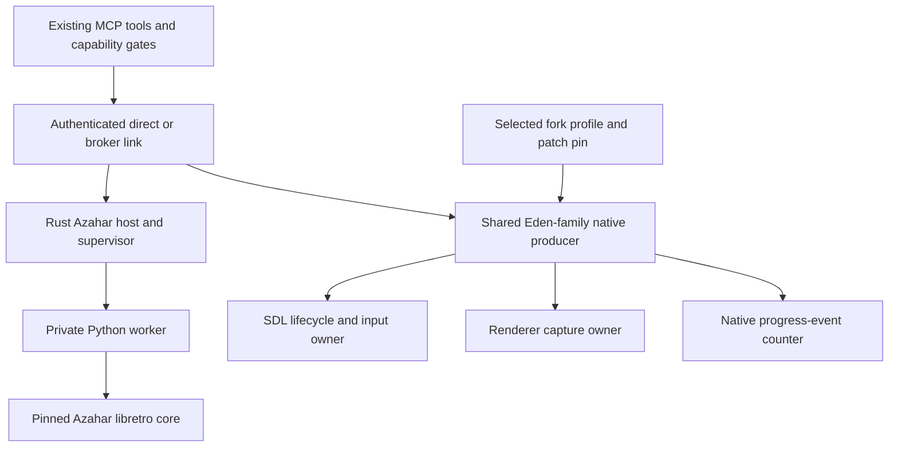
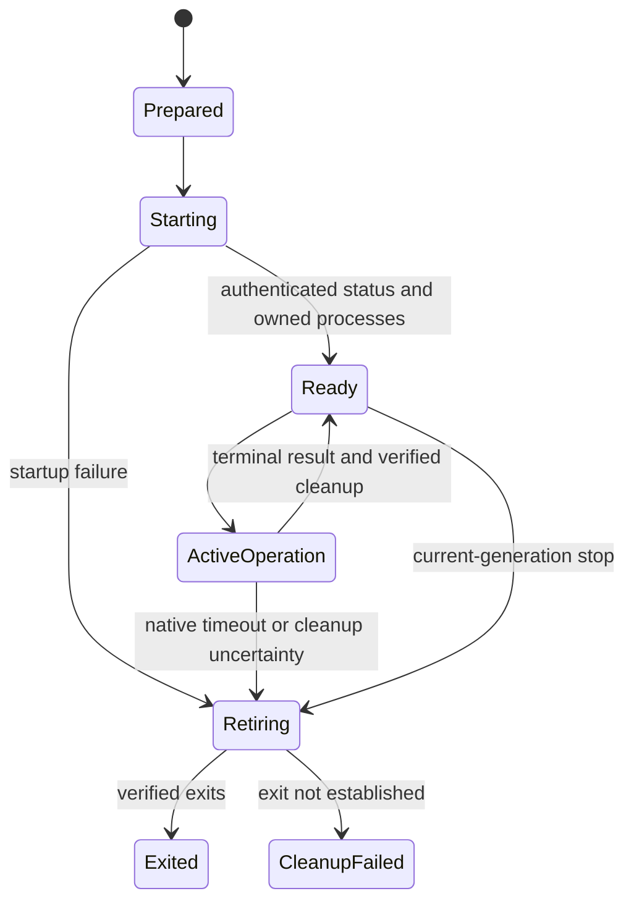
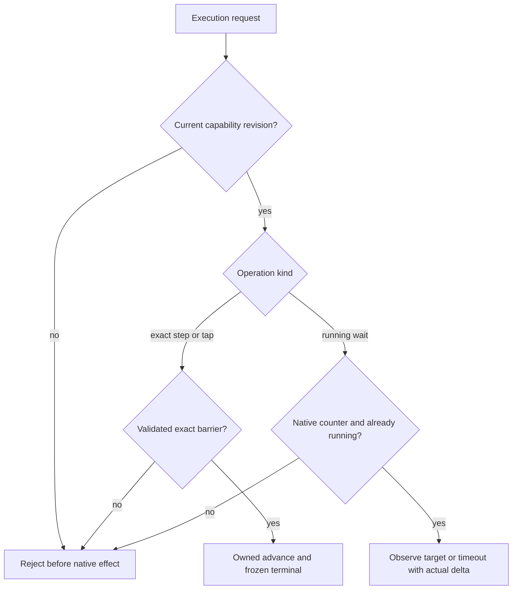
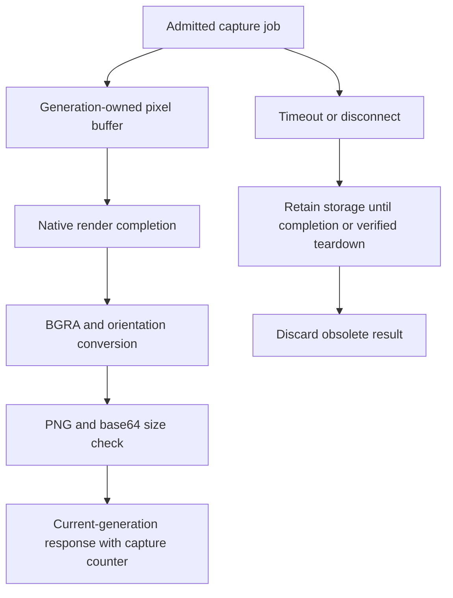

# Azahar and Eden Family Support - Plan

## Goal Capsule

- **Objective:** An emucap user can launch a selected emulator with lawful homebrew, observe the guest, control its supported inputs, and stop it with an accurate account of what was verified.
- **Means:** A supervised Azahar libretro adapter and one maintained source-side bridge for the Eden family, integrated through existing emucap surfaces (KTD1–KTD3).
- **Authority:** Product behavior belongs to the Requirements; implementation choices belong to the Key Technical Decisions. Unit approaches and acceptance examples do not override either.
- **Execution profile:** Eight dependent implementation units in the existing local checkout and feature branch. Treat this as one local change set with reviewable unit boundaries; no push or PR is authorized. A later publication decision can split whole units after dependencies are satisfied.
- **Owner:** The implementing agent owns local implementation, validation and the final evidence report. Dart/CTR runtime development remains in `3ds_flutter`.
- **Stop conditions:** Preserve unrelated edits; stop an affected qualification lane when required lawful assets/tooling are unavailable or native behavior contradicts its advertised contract. Complete independent local work and report the exact blocker. Never substitute build success or an unsupported result for live proof (R10–R12).

---

## Product Contract

### Summary

Complete the inherited Azahar prototype and add Eden, Eden-NX2, Selevet Eglantine and compatible forks through a shared family implementation.
Expose lifecycle, screenshots, controller input, touch and genuine execution controls through emucap's existing agent-facing tools.
Report Switch 2 implementation and qualification separately.

### Problem Frame

The local Azahar adapter is an unregistered Python prototype with no actual Azahar or guest run evidence.
Its wire responses do not yet satisfy emucap's hello, screenshot and temporal contracts.
The Switch forks share emulator infrastructure, but their stock SDL frontends do not provide an emucap endpoint.
Treating repository branding, keyboard replay or a surviving process as working emulator control would give users unreliable automation.

### Requirements

**Selection and lifecycle**

- R1. Support explicit emulator/core, fork, target system and managed configuration selection for Azahar, Eden, Eden-NX2 and Selevet Eglantine; compatible forks use the family protocol without copied adapters.
- R2. Managed launch becomes ready only after compatible-build admission, authenticated producer binding and verified current-generation status; startup failure cleans up owned processes.
- R3. Stop, replacement, timeout and disconnect cleanup act only on the owned generation and report actual cleanup/exit outcomes.
- R4. Isolate configuration, saves, NAND roots, caches and temporary artifacts from the user's normal emulator profile; bind launch identity to all loader-visible guest content.

**Observation and control**

- R5. Capture real rendered guest pixels as bounded PNG responses with dimensions, capture identity and documented freshness/state semantics; capture must not silently resume a paused guest.
- R6. Support digital controller input, native analog axes and single-touch input where the selected emulator/system provides them, with explicit ports, ranges and release semantics.
- R7. Provide bounded frame/progress waiting when a genuine native event counter exists; distinguish that event domain from host calls, CPU instructions and exact frame stepping.
- R8. Advertise exact step/tap/frozen operations only when native execution and cleanup satisfy the existing exactness contracts; unsupported operations reject before mutation.
- R9. Bootstrap, launch planning, status, describe and execute agree on the active backend's capabilities and constraints; a fork/build/layout change invalidates stale capability revisions.

**Qualification and delivery**

- R10. Distinguish source implementation, build success, protocol tests and live guest proof for each fork, system, host and renderer mode, including experimental Switch 2 behavior.
- R11. Supply reproducible build/patch pins, focused tests, CI coverage and headless instructions; missing required fixtures or GPU/display prerequisites produce a named blocked lane, never a passing no-op.
- R12. Use lawful homebrew only, preserve inherited/unrelated work, leave `3ds_flutter` unchanged, and neither push nor create a PR. Commercial ROMs, firmware and keys are not obtained. Luma custom-SVC-dependent CTR probes remain unsupported unless independently implemented and demonstrated.

### Key Decisions

- **Continue in this checkout.** Governs R12. (session-settled: user-directed — chosen over continuing in the separately created T3 thread: the user requested that work continue here.)
- **Truthful temporal and platform support.** Governs R7, R8, R10. A source hook or project claim is insufficient evidence for exact execution or live Switch 2 support.

### Acceptance Examples

- AE1. Covers R1–R4, R9. Selecting an unpatched Eden executable fails preflight with compatible-build guidance; its PID cannot make launch ready.
- AE2. Covers R5, R6. A 3DS fixture displays distinct screen patterns and guest-visible button, analog and touch markers; corner/center coordinates and release are visible in captures.
- AE3. Covers R7, R8. A running wait requests ten native presents and observes twelve; it reports the actual delta and running state without advertising exact step or tap.
- AE4. Covers R3. A stop request carrying the previous launch ID leaves the replacement untouched; a current-generation stop records all owned process exits.
- AE5. Covers R4, R10. Modifying `main.npdm` next to a loose ExeFS `main` changes content identity, even when `main` bytes are unchanged.
- AE6. Covers R10–R12. A Switch 2 binary builds but cannot run the lawful fixture; the report records build proof and the live blocker without marking Switch 2 qualified.

### Scope Boundaries

Implement the requested primitive controls and the contracts necessary to expose them safely.
Memory editing, guest debuggers, save states, recording, multiplayer and multitouch are outside this change.
Do not add a general emulator plugin framework, keyboard/window automation fallback, automatic fork discovery or a new approval workflow; direct source hooks and current selection/ownership mechanisms cover the requested use.
Do not implement Luma custom SVCs or Dart runtime changes here.

#### Deferred to Follow-Up Work

Additional forks can supply a compatible build/profile after the maintained pins work.
An exact stepping barrier for the Eden family is separate work if the audited native hooks cannot satisfy R8; this plan still implements available running-progress waits.

---

## Planning Contract

### Existing Baseline

On `feat/azahar-libretro-bridge`, the offered WIP is `adapters/azahar/{bridge.py,test_bridge.py,README.md,.gitignore}`.
The current bridge covers core loading, digital input/touch, explicit libretro runs and software PNG conversion.
Four Python unit tests, compilation and diff checks were reported earlier in this session; they are historical lower-level evidence, not fresh planning checks or native qualification.
No implementation, tests or emulator execution is performed by this plan-writing task.

### Source Pins and Findings

| Target | Repository/ref and pinned commit | Source-established behavior | Unproven behavior |
|---|---|---|---|
| Azahar | `azahar-emu/azahar`, `9c38437daad90a2f05f55a047d04d4073a476456` | `ENABLE_LIBRETRO`, software composition, digital/analog/touch callbacks | ABI integration, display-free run, native input delivery |
| Eden | `eden-emu/eden` master, `5df599128d6828fa0e42968909da848c255d22b1` | SDL frontend, virtual gamepad/touch engines, renderer screenshots | Patched build and live Switch control |
| Eden-NX2 | `Takoroka/eden-nx2` **eden-nx2 branch**, `50fa86bbbc403ad565eb44fcc281f16f77c69e15` | Switch 2 memory-layout/loader and GPU changes, native present counter | Correct Switch 2 guest execution and input/capture |
| Selevet Eglantine | `sylvieistaken/selevet-eglantine` main, `c3aa97d952b768e8798872d74c21094a340041ff` | Additional Ampere/task/mesh and Switch 2 timing paths | Compatibility, portability and claimed performance |

Eden-NX2's default `master` is not the experimental target.
Concrete Switch 2 source code justifies an experimental target profile, not a working-system claim.
The cited Selevet fork is the requested Eglantine target; broader Eglantine builds are compatible-fork candidates.

### Key Technical Decisions

- KTD1. **Keep the Azahar libretro route, supervised out of process.** The Rust host reuses current authenticated producer/reconnect machinery and owns a private, bounded worker channel. The Python worker retains the inherited pixel/input implementation and serializes every core ABI call on one native owner thread. An OS-level supervisor can retire a worker stuck in `retro_run`; another Python callback cannot safely interrupt it. Record host and worker identities using the existing emulator/bridge process model (R2, R3).
- KTD2. **Use one native SDL bridge module for the Eden family.** Put shared request handling, input, capture and progress ownership under `adapters/eden-family/`; maintain small revision-specific integration patches and profiles. Reuse `adapters/_common/emucap_front_auth.h` and native failure helpers. The module connects as an authenticated producer, avoiding an extra host process where no protocol translation is needed. Direct virtual gamepad/touch APIs make keyboard replay unnecessary (R1, R6).
- KTD3. **Use explicit locked build profiles and runtime readback.** Profiles bind repository/ref/SHA, patch digest, bridge API, target-system set, renderer and CPU/build requirements. Executable/core/config paths are explicit overrides within existing launch arguments. Accept a compatible custom fork only when metadata and live hello agree; reject stock binaries. Build metadata is preflight evidence, not runtime authority (R1, R2, R9).
- KTD4. **Extend current contracts and surfaces rather than add parallel input APIs.** Use existing debug `set_input`, `hold_touch` and `release_touch`; generalize NDS-specific coordinate descriptions and validate advertised bounds. Keep relative pointer tools unchanged. Use `png_base64` and `protocol_version: 1`; producer credentials remain out of band and must never appear in hello/status/logs. Put new touch/progress metadata into the capability revision snapshot (R5, R6, R9).
- KTD5. **Separate observed running progress from exact advancement.** Add a capability-gated debug `wait_for_running_frames` operation with a native counter domain, requested/observed delta, overshoot, execution state and bounded completion. It requires an already-running guest, does not pause/resume it, and returns invalid-state on a paused guest. It can time out when a guest presents nothing. Extend existing cancellation admission/terminal handling for this method without weakening exact-step contracts. Azahar's `retro_run` counter is separately named; exact `step` is enabled only after its presentation boundary and frozen state satisfy R8. No audited Eden hook currently establishes exact stepping.
- KTD6. **Own screenshots through completion or teardown.** Eden's screenshot API retains a raw destination buffer and completes through a detached callback; one generation owns one pending job and keeps its storage alive until callback completion or verified renderer teardown. Busy requests cannot overwrite it. Late callbacks cannot publish into a replacement generation. Preserve a last completed image for paused reads, with its native counter/freshness; requesting a new image while no renderer progress is possible returns unavailable. Convert actual BGRA/orientation into PNG and enforce the protocol size limit (R3, R5).
- KTD7. **Patch only the native gaps established by source.** Azahar needs initialized `MouseTracker` state and fail-closed/readable effective user-directory selection. Eden master needs persistent SDL state/input ownership, correct appstate publication and `SDL_APP_CONTINUE` paths. Add one explicit managed user-root hook for every family path and decouple pending screenshot work from Vulkan's hidden-window early return. These patches are required for the chosen route, not unrelated emulator refactors (R2, R4, R5).
- KTD8. **Bind loose ExeFS to its real file graph.** Extend current content identity/admission/staging for the pinned loader's bounded relative member set, including `main.npdm` and relevant modules. Reject path escapes and bind names plus bytes; staging/readiness use the same content identity. Do not identify a directory by its pathname or only hash `main` (R4).

The shared native bridge versus three copied adapters is resolved by source commonality.
A universal Rust/C++ driver framework is unnecessary, and neither surviving alternative needs a bake-off: the concrete hooks already establish the smaller integration boundary.

### High-Level Technical Design



```mermaid
sequenceDiagram
  participant Caller
  participant Launch as Managed launcher
  participant Backend as Selected backend
  participant Link as Control link
  Caller->>Launch: Plan with explicit system/build/content
  Launch->>Launch: Admit content, isolate roots, prepare generation
  Launch->>Backend: Spawn with private producer credentials
  Backend->>Link: Authenticate then exchange hello
  Link->>Launch: Identity, capabilities and full status
  Launch->>Launch: Verify processes and commit current generation
  Launch-->>Caller: Ready with launch ID and capability revision
```







### System-Wide Impact

Selection touches system normalization, launch-plan preconditions, launch dispatch/specs, binary discovery, installation catalogs and bootstrap output.
Capability work touches both direct and broker links, contracts, debug descriptions, input schemas, status revisions and the existing screenshot tool.
Loose ExeFS affects content staging and tracking identity, whose sole durable writer remains Tracking MCP.
Core release packaging gains the Azahar host and worker resources; native builds gain pinned profiles without altering Pico release behavior.

### Risks and Qualification Dependencies

- **Native hangs:** Azahar's pinned run loop can continue after fatal status. KTD1 provides process retirement; report lost generation rather than successful cancellation without cleanup evidence.
- **Rendering and headless modes:** Display-free software, hidden GPU windows and virtual-display rendering are distinct configurations. A null renderer cannot qualify capture. KTD6/KTD7 address ownership and hidden rendering; U8 tests actual environments.
- **Toolchains:** Azahar upstream has Linux, macOS and MinGW Windows libretro recipes; native MSVC core support is not established. Rust host and core must match architecture. Eglantine's Zen 3 tuning must not leak into generic distributable presets.
- **Legal Switch 2 fixture:** Loader and shader support do not establish availability of a runnable lawful fixture/toolchain. U8 creates the fixture source and records any remaining build/loader dependency as a live blocker under R10–R12.
- **Upstream drift:** Every patch/build uses the recorded pin. Updating a pin requires source compatibility checks and requalification of affected capabilities.

No product decision blocks starting implementation.
Native build success, exact-boundary viability, capture while paused and lawful Switch 2 guest execution are execution-time qualification questions with the owning gates in R5–R12.

---

## Implementation Units

### U1. Define family profiles and capability contracts

**Goal:** Establish the shared selection and truthful capability model before exposing new backends.

**Requirements:** R1, R5–R10. **Dependencies:** None.

**Files:** New `src/emulator_profile.rs`, `src/emulator_profile_tests.rs`; `src/lib.rs`, `src/contracts.rs`, `src/contracts_tests.rs`, `contracts/catalog.json`, `src/live/link.rs`, `src/live/temporal.rs`, `src/live/temporal_tests.rs`, `src/bin/emucap-mcp/status/capability_revision.rs` and its tests; new family profile/lock data in `adapters/eden-family/` and `adapters/azahar/upstream.lock`.

**Approach:** Implement KTD3–KTD5's data/contract boundary and assign one owner for each profile and capability. Keep new public operations gated until a producer supplies validated contracts. Record experimental systems independently of fork names.

**Patterns to follow:** `adapters/dolphin/upstream.lock`, `src/live/link.rs::FeatureCapabilities`, `src/live/temporal.rs::CancellationCapability`.

**Test scenarios:**

- Missing/unsupported bridge API or conflicting build/system metadata fails admission.
- Distinct Switch-only and Switch 2 profiles produce distinct capability revisions.
- A profile advertising only a present counter cannot enable exact step, tap or scoped-controller semantics.
- A credential-bearing hello is rejected by the existing handshake; profile/status serialization contains no token.

**Verification:** Profile/contract/revision tests prove fail-closed capability parsing without changing current adapters' advertisements.

### U2. Build the supervised Azahar host and harden the ABI worker

**Goal:** Make the offered Python bridge a bounded, managed native-core worker.

**Requirements:** R2–R5, R9. **Dependencies:** U1.

**Files:** `adapters/azahar/bridge.py`, `adapters/azahar/test_bridge.py`; new `adapters/azahar/tests/` ABI fixture shared-library sources; new `src/azahar_host.rs`, `src/azahar_host_tests.rs`, `src/bin/emucap-azahar.rs`; `src/lib.rs`, `Cargo.toml`; existing reconnect/runtime tests where reused behavior changes.

**Approach:** Implement KTD1/KTD4. Validate API version, symbols, system info and full-path requirements; retain callbacks/strings and latch callback exceptions as ABI-safe failures. Separate native diagnostics from framed replies. Bound reads before allocation and PNG output before transmission. Close only initialized/loaded stages, once. Return worker process identity in a private startup receipt so managed launch records both processes.

**Execution note:** Add an executable fake libretro core fixture before refactoring lifecycle code; Python object-only tests cannot establish ABI behavior.

**Patterns to follow:** `src/bin/emucap-mupen64plus.rs`, `src/live/reconnect.rs`, `src/live/producer_auth.rs`, `src/live/protocol.rs`, generation-owned two-process launch handling.

**Test scenarios:**

- Successful load/run/unload obeys ABI ordering; load rejection, missing symbol and partial init clean up correctly.
- Callback failure, core shutdown, malformed request, oversized line and oversized screenshot fail without corrupting the next protocol frame.
- Native diagnostic stdout cannot masquerade as a reply.
- Hung native run causes bounded host-supervised worker termination and terminal generation failure.
- Direct and broker hello reach existing parsers with correct identity and `png_base64` capture results.

**Verification:** Real subprocess/ABI and transport tests pass; worker/host exit evidence accompanies timeout tests. This does not qualify actual Azahar.

### U3. Complete Azahar native input, capture and execution controls

**Goal:** Deliver the core-facing behavior and maintained patch/build recipe for CTR.

**Requirements:** R4–R8, R10, R11. **Dependencies:** U2.

**Files:** `adapters/azahar/bridge.py`, tests; new `adapters/azahar/{build.sh,build.ps1,patches/}` and native regression fixture; `src/azahar_host.rs`, `src/azahar_host_tests.rs`.

**Approach:** Apply KTD7 to initialized touch state and effective storage readback. Pin software/New 3DS/layout options and the explicit C-stick role. Implement native analog axes, layout-derived touch mapping and copied software frames. Distinguish host-run, video/presentation and guest-fixture counters. Preserve serialized ABI calls and add only the execution subset justified by KTD5/R8.

**Patterns to follow:** Pinned `src/citra_libretro/{core_settings.cpp,citra_libretro.cpp,input/mouse_tracker.h,input/input_factory.cpp}` and `adapters/dolphin/` build/patch provenance.

**Test scenarios:**

- Touch corners and center round-trip through pinned native decoding, including release before the first press.
- Circle Pad/C-stick neutral, extremes and diagonals use correct signed ranges/Y mapping; release clears both.
- Geometry updates, padded pitch, duplicate frames, unsupported hardware callbacks and channel conversion retain truthful image identity.
- Failure to establish the effective managed `Azahar/` directory aborts before guest effects.
- Any exact-step advertisement is accompanied by exact native boundary and no-free-progress assertions; host-call counting alone fails that qualification.

**Verification:** Patched pinned core builds on supported toolchains; ABI/native tests establish mappings and storage behavior. U8 supplies guest and headless proof before claims are promoted.

### U4. Implement one Eden-family native bridge

**Goal:** Add native lifecycle, input, capture and observed-progress control to all three pinned forks.

**Requirements:** R1–R8, R10, R11. **Dependencies:** U1.

**Files:** New `adapters/eden-family/{native/,patches/,profiles/,build.sh,build.ps1,tests/}`; shared auth/failure helper tests only if their interfaces change.

**Approach:** Implement KTD2, KTD5–KTD7 with small per-pin patches. Repair Eden master's SDL state/input lifecycle using the established fork ownership shape. Publish readiness after guest/input/renderer initialization. Dispatch input and lifecycle changes to their native owner thread. Add virtual gamepad/touch injection and an atomic progress hook at a documented native event. Implement the single pending capture owner and managed user-root hook. Use shared producer auth/reconnect behavior; do not depend on environment replay scripts.

**Execution note:** Characterize frontend partial-init/quit and screenshot completion lifetimes before adding endpoint effects.

**Patterns to follow:** Pinned `src/yuzu_cmd/yuzu.cpp`, `src/input_common/drivers/{virtual_gamepad,touch_screen}.h`, `src/video_core/renderer_base.cpp`; `adapters/_common/{emucap_front_auth.h,emucap_native_failure.h}`.

**Test scenarios:**

- Each pin applies/builds its thin glue without copying the common bridge module.
- Partial startup and quit safely release owned SDL/input/renderer state; no callbacks retain AppInit locals.
- Native button/stick/touch replacement and release honor validated ports and bounds.
- Capture channel/orientation markers convert correctly; timeout plus late completion cannot free/reuse pending storage.
- Hidden Vulkan capture is serviced independently of presentation; null-render capture rejects explicitly.
- Progress wait reports overshoot, stalls at deadline, cancels with a keyed terminal, and never turns on exact step.

**Verification:** Shared native tests and per-pin build/contract smoke pass. Record platform/backend build limitations explicitly; U8 remains the guest proof gate.

### U5. Add managed launch and content identity

**Goal:** Launch the selected compatible build in an isolated generation with complete guest identity.

**Requirements:** R1–R4, R9. **Dependencies:** U1, U2, U4; Azahar native readiness additionally needs U3.

**Files:** New `src/launch/{azahar,eden_family}.rs` and matching tests; `src/launch/{mod,spec}.rs`, `src/bin/emucap-mcp/{args,args_tests,launch_tests}.rs`, `src/bin/emucap-mcp/launch/{system,plan,run,media}.rs`; new launch helper tests; `src/content_identity.rs`, `src/content_identity_tests.rs`, runtime manifest/termination tests as required.

**Approach:** Wire KTD3/KTD7/KTD8 into current launch prepare/auth/readiness/commit and stop ownership. Add normalized `3ds`, `switch` and `switch2` system routing with explicit fork selection. Include all owned Azahar processes in startup and termination evidence. Bind and stage the pinned loader's loose ExeFS graph through existing indirect-media admission. Reject unpatched stock fallback and unexpected profile-root fallback.

**Patterns to follow:** `src/launch/dolphin.rs`, `src/bin/emucap-mcp/launch/run.rs`, `src/bin/emucap-mcp/stop.rs`, `src/content_identity.rs` composite graph/staging.

**Test scenarios:**

- Covers AE1. An unpatched or mismatched executable fails before managed spawn.
- Paths with spaces and explicit config/core overrides produce the intended process specs and isolated roots on each OS.
- Handshake failure or host/worker exit aborts startup without leaving a false current generation.
- Covers AE4. A stale stop cannot signal the replacement; current stop verifies every owned process exit.
- Covers AE5. Changing metadata/module bytes changes ExeFS identity; missing companion, path escape and changed content before stage/launch fail admission.

**Verification:** Pure launch-spec tests plus subprocess generation tests prove selection, identity, cleanup and root isolation. Live identity readback is checked in U8.

### U6. Expose capabilities through the existing MCP surfaces

**Goal:** Make the implemented backend operations usable and discoverable without misleading schemas.

**Requirements:** R5–R9. **Dependencies:** U1–U5.

**Files:** `src/bin/emucap-mcp/{status,status_tests,args,args_tests,debug_input,debug_input_tests,debug_surface}.rs`, status capability modules/tests, existing execution/debug routing modules located by their operation tables; `src/live/{link,tools,temporal}.rs`, `src/live/tools/` tests; `contracts/catalog.json`, `src/contracts_tests.rs`; new progress-wait capability/tool tests.

**Approach:** Implement KTD4/KTD5 in describe/execute, runtime input validation, cancellation admission and result schemas. Add `wait_for_running_frames` to debug rather than exporting the legacy hidden `run_frames` wire method. Keep unsupported domains absent. Update bootstrap/system/install catalogs and verify screenshot through its existing tool. Use contract-gated touch bounds; do not change relative pointer semantics.

**Patterns to follow:** `src/bin/emucap-mcp/debug_input.rs`, `pointer_surface.rs` gating, `src/live/tools/screenshot.rs`, current temporal owner/wire cancellation terminals.

**Test scenarios:**

- A 320x240 CTR touch profile accepts its edges while an NDS profile retains its existing bounds.
- Covers AE3. Native present wait returns actual delta/overshoot and state; a paused guest rejects before effects.
- A stale revision after fork/build/layout change rejects mutation.
- Capture-only/running-only builds expose neither frozen-step nor exact-tap operations.
- Raw persistent input/touch stays available through validated contracts without requiring scoped exact-input features.
- Public launch/status/describe/input/capture/wait/stop flows pass through protocol-faithful direct and broker producers.

**Verification:** MCP schema, contract, revision and routed-operation integration tests pass for both new families and representative existing NDS/Dolphin profiles.

### U7. Add build, packaging and CI lanes

**Goal:** Make supported build/test routes reproducible without presenting unavailable native lanes as passing.

**Requirements:** R10–R12. **Dependencies:** U3–U6.

**Files:** `.github/workflows/{core-validation,native-adapters,native-unix}.yml`, new `.github/workflows/emulator-bridge-validation.yml` if separate scheduling is needed; `_tests/release/package_core.py` and its existing package tests; `Cargo.toml`; build/lock files from U3/U4; `_tests/native/` or adapter-local native test runners.

**Approach:** Package the Rust Azahar host plus worker/resources and add explicit native profile lanes. Run fast protocol/ABI tests in normal CI; pinned native builds and live homebrew smokes are named distinct jobs with artifact evidence. Start Linux software Azahar and Linux GPU/virtual-display Eden-family qualification; run Windows/macOS build/package lanes where toolchains are supported. Document unqualified platform modes rather than silently broadening support. Preserve existing Core and Pico workflows under R12.

**Test scenarios:**

- Clean extracted packages locate the worker/resources and report missing core/native dependencies accurately.
- Every requested maintained source pin appears in a build lane or a named unsupported/blocked platform entry.
- Missing fixture/GPU/display produces explicit nonqualification evidence, never an empty successful smoke.
- Generic CPU presets do not accidentally enable Eglantine-specific Zen 3 instructions.

**Verification:** CI definitions validate, package smoke uses extracted artifacts, and each reported green lane performs its named proof level.

### U8. Qualify lawful guests and publish support documentation

**Goal:** Establish the actual supported matrix and leave reproducible evidence and runbooks.

**Requirements:** R1–R12. **Dependencies:** U3–U7.

**Files:** New `_tests/live/azahar/` and `_tests/live/eden-family/` homebrew fixture sources, build manifests and smoke harnesses; `adapters/azahar/README.md`, new `adapters/eden-family/README.md`; `README.md`, `AGENT_GUIDE.md`, `COMPATIBILITY.md`, `FORK.md`, `NOTICE` and applicable license records.

**Approach:** Build minimal CTR, Switch and Switch 2 homebrew from lawful source/tooling; use an offline internal-data fixture for Switch 2 loader/shader ABI needs. Record exact toolchain, fixture member hashes, emulator/patch/config/host/renderer identities and results. Qualify the selected fork/system combinations independently, including Switch compatibility on experimental forks rather than assuming inheritance. Update docs to the measured matrix and correct the prototype's obsolete no-patch/no-registration statements.

**Test scenarios:**

- Covers AE2. CTR shows screen composition, advancing guest counter, button/analog consumption and corner/center touch/release.
- Switch and Switch 2 fixtures independently show guest identity, rendered pattern, digital/analog/touch response and release on each claimed fork/system.
- Native progress observations and any advertised exact boundary are compared with guest-visible counters; frozen observations show no free progress.
- Display-free software and GPU virtual-display modes capture actual pixels under their documented prerequisites.
- Disconnect, active-wait cancellation, capture timeout and managed stop produce cleanup and process evidence.
- Covers AE6. A blocked lawful Switch 2 fixture lane remains explicitly unqualified while lower-level results remain visible.

**Verification:** Evidence artifacts establish each claimed support cell; unsupported/blocked cells state the actual limitation and recovery prerequisite. No commercial asset or guest-security workaround is introduced.

---

## Verification Contract

Implementation uses the repository's required checks below; this planning task runs none of them.
Use a real Python interpreter on Windows (`py -3.12`), since `python` resolved to the Store stub earlier.

| Layer | Checks during implementation | Evidence boundary |
|---|---|---|
| Formatting | `cargo fmt --all -- --check`; `git diff --check` | Formatting only |
| Python worker | `py -3.12 -m unittest discover -s adapters/azahar -p 'test_*.py'`; Python compilation | Worker behavior; fake ABI tests must actually load their compiled library |
| Rust core | `cargo test --locked --release --all-targets`; `cargo clippy --locked --release --all-targets -- -D warnings` | Contract/host/launch behavior, including dependent existing adapters |
| Binaries/package | `cargo build --locked --release --bins`; existing `_tests/release/package_core.py` target invocation from Core CI | Build and extracted package proof |
| Native builds | U3/U4 pinned build scripts and native regression runners | Source/ABI/native hook proof per fork and host |
| Live guests | U8 harnesses under wall-clock supervisors with screenshots, counters, logs and exit records | Actual emulator/system behavior for the exact fixture/config |

Tests for shared contract/schema/input changes include transitive users, especially NDS touch, Dolphin lifecycle and direct/broker authentication.
Baseline any failing required checks before attributing them to this change.
Results record requested/completed counts, timeout/crash/cleanup outcome and unsupported capabilities distinctly.
A skipped or blocked live lane cannot satisfy R10/R11.

---

## Definition of Done

- U1–U7 produce working local integrations and reproducible builds/tests with their stated verification evidence.
- U8 supplies live proof for every claimed support cell; unavailable cells remain explicitly experimental/unqualified with precise blockers under R10/R11.
- All requested operations are implemented where native support exists, and absent capabilities fail before mutation under R8.
- Selected build identity, effective managed roots and loader-visible guest identity agree across launch, hello/status, captures and evidence.
- Required checks pass or have separately established baseline failures with an explicit disposition.
- Documentation distinguishes source, build, protocol and live evidence; no screenshot or process-survival check stands in for guest input or exact execution proof.
- Remove abandoned-attempt code and temporary production scaffolding. Preserve user WIP, separate Core/Pico workflows and R12's repository/publication boundaries.
- Final handoff names exact changed paths, checks, qualified combinations and remaining blockers. Do not describe the entire emulator integration as live-qualified while required guest lanes remain blocked.

---

## Sources and Research

Repository anchors: `src/live/{protocol,tcp,link,producer_auth,temporal}.rs`, `src/live/tools/screenshot.rs`, `src/bin/emucap-mcp/{debug_input,pointer_surface,stop}.rs`, `src/bin/emucap-mcp/launch/{system,plan,run,media}.rs`, `src/launch/dolphin.rs`, `src/content_identity.rs`, `contracts/catalog.json`, `.github/workflows/core-validation.yml` and `_tests/release/package_core.py`.

- [Azahar pinned libretro target](https://github.com/azahar-emu/azahar/tree/9c38437daad90a2f05f55a047d04d4073a476456/src/citra_libretro): `citra_libretro.cpp`, `core_settings.cpp`, `environment.cpp`, `input/mouse_tracker.h`, `input/input_factory.cpp` and `emu_window/libretro_window.cpp` establish KTD1/KTD7 and U3.
- [Azahar pinned platform recipes](https://github.com/azahar-emu/azahar/blob/9c38437daad90a2f05f55a047d04d4073a476456/.github/workflows/libretro.yml): platform/toolchain lanes for U7.
- [Eden pinned SDL frontend](https://git.eden-emu.dev/eden-emu/eden/src/commit/5df599128d6828fa0e42968909da848c255d22b1/src/yuzu_cmd/yuzu.cpp) and [SDL callback result contract](https://wiki.libsdl.org/SDL3/SDL_AppResult): lifecycle corrections for KTD7/U4.
- [Eden virtual gamepad](https://git.eden-emu.dev/eden-emu/eden/src/commit/5df599128d6828fa0e42968909da848c255d22b1/src/input_common/drivers/virtual_gamepad.h) and [touch engine](https://git.eden-emu.dev/eden-emu/eden/src/commit/5df599128d6828fa0e42968909da848c255d22b1/src/input_common/drivers/touch_screen.h): KTD2's shared native input seam.
- [Eden renderer ownership](https://git.eden-emu.dev/eden-emu/eden/src/commit/5df599128d6828fa0e42968909da848c255d22b1/src/video_core/renderer_base.cpp), [Vulkan capture path](https://git.eden-emu.dev/eden-emu/eden/src/commit/5df599128d6828fa0e42968909da848c255d22b1/src/video_core/renderer_vulkan/renderer_vulkan.cpp), and [path roots](https://git.eden-emu.dev/eden-emu/eden/src/commit/5df599128d6828fa0e42968909da848c255d22b1/src/common/fs/path_util.cpp): KTD6/KTD7.
- [Eden-NX2 actual experimental core](https://git.eden-emu.dev/Takoroka/eden-nx2/src/commit/50fa86bbbc403ad565eb44fcc281f16f77c69e15/src/core/core.cpp) and [SDL frontend](https://git.eden-emu.dev/Takoroka/eden-nx2/src/commit/50fa86bbbc403ad565eb44fcc281f16f77c69e15/src/yuzu_cmd/yuzu.cpp): concrete experimental implementation and replay limitations.
- [Selevet Eglantine pinned source](https://github.com/sylvieistaken/selevet-eglantine/tree/c3aa97d952b768e8798872d74c21094a340041ff), especially `src/shader_recompiler/shader_info.h` and `src/core/memory.cpp`: experimental Switch 2 paths, without live qualification evidence.
